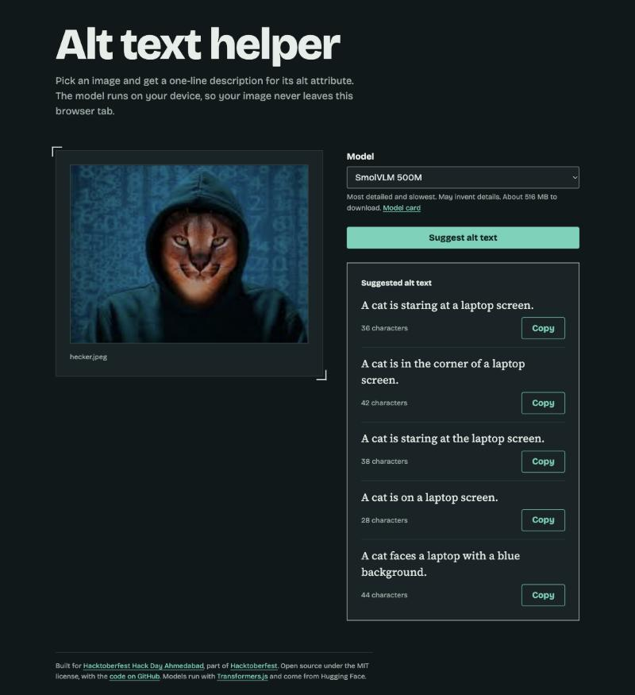

# Alt text helper

Pick an image and get three to five alt text options for it. An open-weight captioning model runs in your browser, so the image never leaves your device. There is no server, no account and no API key.

**For whom:** anyone who publishes images on the web and wants a quick, private starting point for alt text, such as bloggers, developers, students and content teams.

**Live demo:** [imagealttexthelper.netlify.app](https://imagealttexthelper.netlify.app/)



## Why

Alt text is easy to skip and hard to write well. Most tools that suggest it send your image to a hosted API. This one runs the model locally with [Transformers.js](https://huggingface.co/docs/transformers.js), which keeps private images private and removes any cost or quota.

## Features

- Three to five distinct alt text options per image, shown as they are generated
- Character count for each option, with a note when it is long for alt text (over 125 characters)
- Model picker with four open models, from small captioners to vision-language models
- Copy button on every option
- Drag and drop or file picker, keyboard accessible, light and dark themes

## Open-source AI used

The models are the engine of the app. Every caption comes from an open-weight model running on the visitor's device through [Transformers.js](https://huggingface.co/docs/transformers.js) and [ONNX Runtime Web](https://onnxruntime.ai/).

| Model                                                                      | License    | Download     |
| -------------------------------------------------------------------------- | ---------- | ------------ |
| [DistilViT by Mozilla](https://huggingface.co/Mozilla/distilvit) (default) | Apache-2.0 | about 190 MB |
| [ViT-GPT2](https://huggingface.co/Xenova/vit-gpt2-image-captioning)        | Apache-2.0 | about 245 MB |
| [SmolVLM 256M](https://huggingface.co/HuggingFaceTB/SmolVLM-256M-Instruct) | Apache-2.0 | about 264 MB |
| [SmolVLM 500M](https://huggingface.co/HuggingFaceTB/SmolVLM-500M-Instruct) | Apache-2.0 | about 516 MB |

DistilViT and ViT-GPT2 are image captioners that return short generic captions. The SmolVLM models are small vision-language models that follow an instruction, so they notice more detail. They are slower, and they can invent details.

The model downloads on first use and is cached by the browser. Sizes are estimated from the quantized files in each repository.

ViT-GPT2 is Xenova's ONNX conversion of [nlpconnect/vit-gpt2-image-captioning](https://huggingface.co/nlpconnect/vit-gpt2-image-captioning), which is licensed Apache-2.0. The conversion repository does not state a license of its own.

## Run it

```bash
npm install
npm run dev
```

Node 22.12 or newer is required.

| Script                 | What it does                              |
| ---------------------- | ----------------------------------------- |
| `npm run dev`          | Start the dev server                      |
| `npm run build`        | Type check and build to `dist`            |
| `npm run preview`      | Serve the build with its security headers |
| `npm test`             | Run the unit tests                        |
| `npm run lint`         | Lint with ESLint                          |
| `npm run typecheck`    | Type check with TypeScript                |
| `npm run format:check` | Check formatting with Prettier            |

## How it works

- `src/worker/caption.worker.ts` loads the model and runs it off the main thread, so the page stays responsive.
- The worker produces one best caption, then sampled captions until it has between three and five distinct ones. The library returns one caption per call, so the variety comes from repeated sampling. Captioners use beam search for the first one. Vision-language models answer the prompt "Describe this image in one short sentence for alt text." and the answer is trimmed to its first sentence.
- `src/hooks/captionReducer.ts` holds the state machine. Requests carry an id, so results from an earlier image or model are ignored.
- `src/lib/altText.ts` formats captions as sentences and removes duplicates.

## Deploy

The build is a static site. On Netlify, `netlify.toml` sets the build command and publish directory. The build also writes `dist/_headers`, which Netlify applies, including the Content Security Policy.

The ONNX runtime file is about 27 MB, which is above the per-file limit of some static hosts. Check your host's limit before choosing it.

## Privacy and security

Images are processed in your browser and are never uploaded. The page only contacts Hugging Face to download model files. See [SECURITY.md](SECURITY.md).

This project follows secure development practices that line up with SOC 2 principles, such as a strict Content Security Policy, no stored user data and automated dependency updates. It has not been audited and is not SOC 2 certified.

## Limitations

- Captions are short and generic. Review each one and add context only you know, such as names and the purpose of the image.
- Small models can be wrong. They are a starting point, not a replacement for a person writing alt text.
- The first run needs a download of 190 to 516 MB, depending on the model.
- The SmolVLM models are the most accurate here but can still invent details, for example text that is not in the image.
- Inference runs on the CPU through WebAssembly, so each option takes a few seconds.

## Built by

[Akshar Goyal](https://github.com/AksharGoyal), at [Hacktoberfest Hack Day Ahmedabad](https://www.mlh.com/events/hacktoberfest-hack-day-ahmedabad-x-open-source-weekend) on 24 October 2026. All project code was written during the event.

## Credits

- **Models:** [DistilViT](https://huggingface.co/Mozilla/distilvit) by Mozilla. [vit-gpt2-image-captioning](https://huggingface.co/nlpconnect/vit-gpt2-image-captioning) by nlpconnect, converted to ONNX by [Xenova](https://huggingface.co/Xenova). [SmolVLM](https://huggingface.co/HuggingFaceTB/SmolVLM-500M-Instruct) by Hugging Face.
- **Inference:** [Transformers.js](https://huggingface.co/docs/transformers.js) by Hugging Face and [ONNX Runtime Web](https://onnxruntime.ai/) by Microsoft.
- **App:** [React](https://react.dev), [Vite](https://vite.dev) and [TypeScript](https://www.typescriptlang.org). The project structure follows the Vite React TypeScript template conventions. No template code was copied.
- **Tooling:** [Vitest](https://vitest.dev), [ESLint](https://eslint.org), [Prettier](https://prettier.io), [Husky](https://typicode.github.io/husky), [lint-staged](https://github.com/lint-staged/lint-staged) and [commitlint](https://commitlint.js.org).
- **Fonts:** [Bricolage Grotesque](https://fonts.google.com/specimen/Bricolage+Grotesque) and [Source Serif 4](https://fonts.google.com/specimen/Source+Serif+4), self-hosted with [Fontsource](https://fontsource.org).
- **Hosting:** [Netlify](https://www.netlify.com).
- **Screenshot image:** a "hacker caracal" meme image supplied by the author. The original creator is unknown.
- **AI assistance:** developed with help from Claude Code by Anthropic.

## Contributing

See [CONTRIBUTING.md](CONTRIBUTING.md). Commits follow [Conventional Commits](https://www.conventionalcommits.org).

## License

[MIT](LICENSE)
